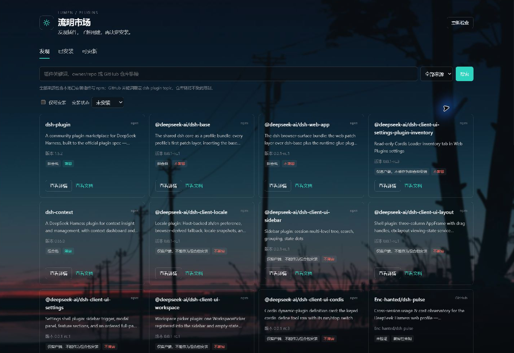
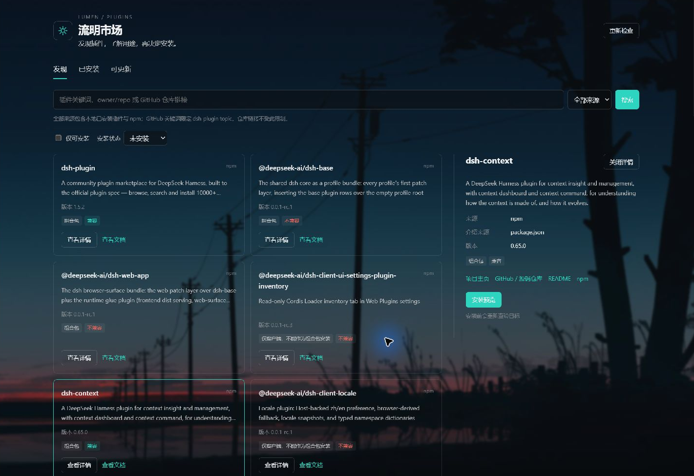

# 流明市场 · Lumen Market


为 [DeepSeek Harness](https://github.com/deepseek-ai/deepseek-harness) 提供一个集**插件发现、介绍、文档、安装和更新**于一体的市场。你可以搜索 npm 与 GitHub 插件，也可以查看当前已安装的本地插件。

安装和更新由 DSH 官方插件管理器执行。点击确认前，市场会展示查验过的版本或 commit，以及兼容性信息。

## 实机截图

以下图片直接截取自运行中的 **DeepSeek Harness 桌面应用**，不是离线演示或设计稿。使用了自定义宿主主题；为保护隐私，仅裁去侧栏、会话列表和余额区域。截图中的版本和结果代表拍摄时的状态。

**发现插件：查看来源、简介、版本和兼容性。**



**插件详情：阅读完整介绍，打开项目主页、仓库和 README。**



## 能做什么

| 功能 | 用途 |
| --- | --- |
| 搜索插件 | 搜索 npm 与 GitHub，或直接输入仓库地址 |
| 了解插件 | 查看简介、完整描述和文档入口 |
| 安装前查验 | 展示兼容性、确切版本或固定 commit |
| 查看已安装 | 识别 npm、本地链接、Git 等不同来源 |
| 检查更新 | 查找可更新的 npm 插件，逐项预览并原地升级 |
| 重启提醒 | 更新后持续提示需要重启的插件 |

## 安装

使用带有官方插件管理功能的 DeepSeek Harness。仓库已经包含可加载的 `lib/` 文件，无需自行构建。

### 在 DSH 中添加

1. 打开侧栏 **「插件」→「添加插件」**。
2. 填入下面的安装目标。它固定到已验证的 `0.1.0` 代码提交：

   ```text
   github:Femad-6/dsh-lumen-market#652e9286e5d21499ada26c1dd244447379a793fd
   ```

3. 确认安装，按官方管理器的提示处理构建授权或重启。
4. 安装生效后，侧栏会出现 **「流明市场」**。

如需安装其他提交，可在 [GitHub 提交列表](https://github.com/Femad-6/dsh-lumen-market/commits/main/) 中复制完整 SHA，替换安装目标末尾的 commit。

### 从本地目录安装

适合希望修改代码或本地测试的用户。需要 Git、Node.js 22 或更高版本，以及 npm。

```sh
git clone https://github.com/Femad-6/dsh-lumen-market.git
cd dsh-lumen-market
npm ci --omit=dev --ignore-scripts --no-audit --no-fund
```

然后在 DSH「添加插件」中输入克隆目录的**绝对路径**。例如，克隆目录是 `C:\Plugins\dsh-lumen-market`，就填写该路径。请替换为你自己的实际目录。

本地安装通常会建立 link/junction。安装后不要移动目录；修改 host 代码后，需要正常退出并重新打开 DSH。

## 开始使用

1. **找插件**：进入「发现」，输入关键词、`owner/repo` 或 GitHub 仓库根地址，选择来源后点击「搜索」。
2. **看介绍**：点击「查看详情」，阅读描述与兼容性，使用「查看文档」了解更多。
3. **装插件**：目标符合条件时，点击「安装预览」，核对版本或 commit，再点击「确认安装」。
4. **查更新**：进入「已安装」或「可更新」，点击「重新检查」。有更新时，逐项预览和确认。

只检查或浏览不会自动安装、更新插件。待重启提示在刷新页面后仍会保留，真正重启 DSH 后才清空。

## 搜索来源

| 来源 | 搜索范围 |
| --- | --- |
| npm | 宿主配置的注册表；默认使用 npm 官方源，并带 npmmirror 回退 |
| GitHub | 关键词搜索限定 `dsh-plugin` topic，按最近更新排序；直接输入仓库根地址可查验没有这个 topic 的仓库 |
| 全部来源 | 合并 npm 与 GitHub，并在第一页显示匹配的本地已安装插件 |

GitHub 搜索不是全仓库扫描。搜索结果只是候选，需要打开详情完成查验，才可能提供安装按钮。

## 常见问题

**为什么搜不到某个插件？**

检查来源和筛选条件。找本地安装的插件时，选择「全部来源」并关闭「仅可安装」，或者进入「已安装」。找 GitHub 项目时，包名可能与仓库名不同；直接输入完整仓库地址更准确。网络失败、限流或注册表尚未收录也会影响结果。

**为什么显示“未验证”，没有安装按钮？**

首版只直接安装仓库根目录的单包插件。缺少 DSH 声明、缺少构建产物、导出路径无法完整查验或不兼容时，会显示原因。只有客户端模块、monorepo 子包和无法固定 commit 的目标也不会直接安装。静态查验不能保证插件运行成功，最终结果仍由官方管理器决定。

**为什么本地链接和 Git 插件没有升级按钮？**

按 npm 包名升级会替换原来的安装来源，因此只对符合条件的 npm 依赖提供更新。本地 link/file、Git、压缩包和 npm 别名不会被转换成注册表安装，也不会自动追踪新的 Git commit。

**安装或更新失败怎么办？**

查看页面错误和官方管理器的诊断。兼容性拒绝会说明不满足的 peer 范围；构建脚本授权也由官方处理。市场不会自动授权脚本、写入兼容性豁免或重试安装。若提示 profile 定位异常，可点击页面底部「诊断」查看原因；分享诊断前请检查路径等个人信息。

**GitHub 限流怎么办？**

等待页面显示的重试时间。匿名查询可用；需要提高配额时，可以在启动宿主的环境中设置专用变量 `DSH_LUMEN_MARKET_GITHUB_TOKEN`，具体说明见开发文档。不要将 token 放进仓库或截图。

## 开发与反馈

开发命令、接口和验证说明见 [开发文档](docs/DEVELOPMENT.md) 与 [验证摘要](docs/VALIDATION.md)。离线预览使用模拟 API，实机截图来自桌面应用；当前没有通过自动化执行真实插件升级或失败回滚验收。

遇到问题可提交 [Issue](https://github.com/Femad-6/dsh-lumen-market/issues)，附上 DSH 版本、操作步骤和去除敏感信息后的截图。

## 许可证

MIT。第三方依赖说明见 [THIRD_PARTY_NOTICES.md](THIRD_PARTY_NOTICES.md)。
