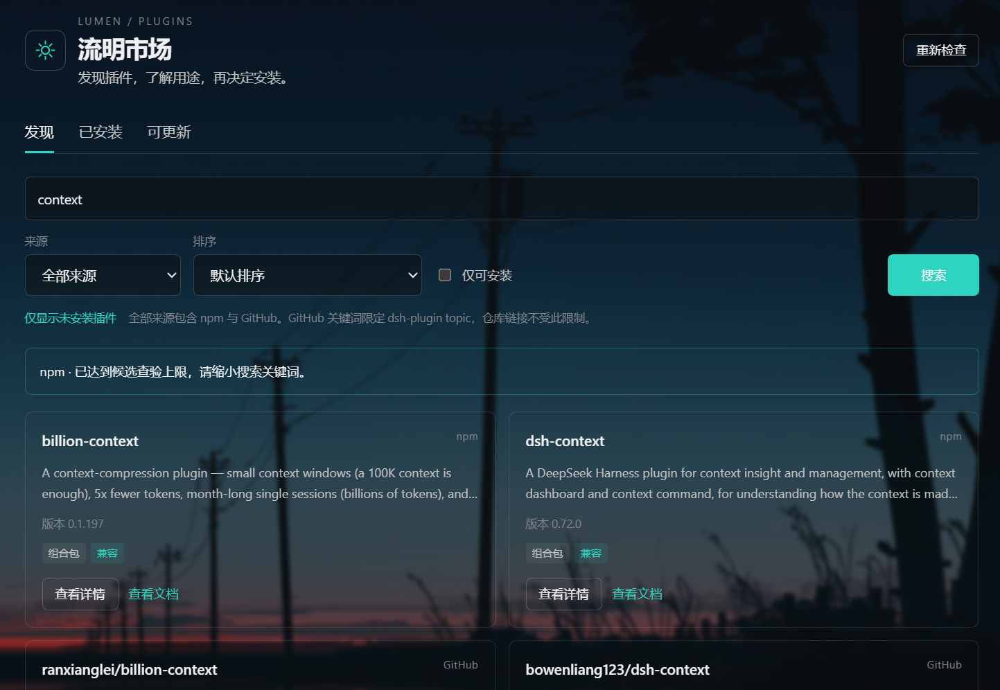
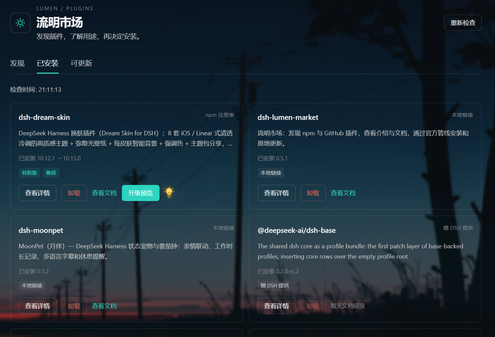
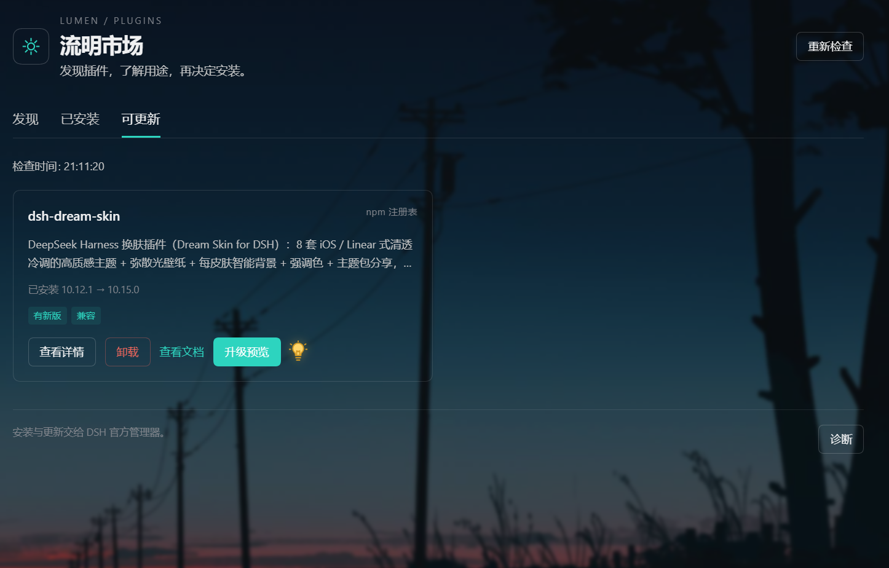
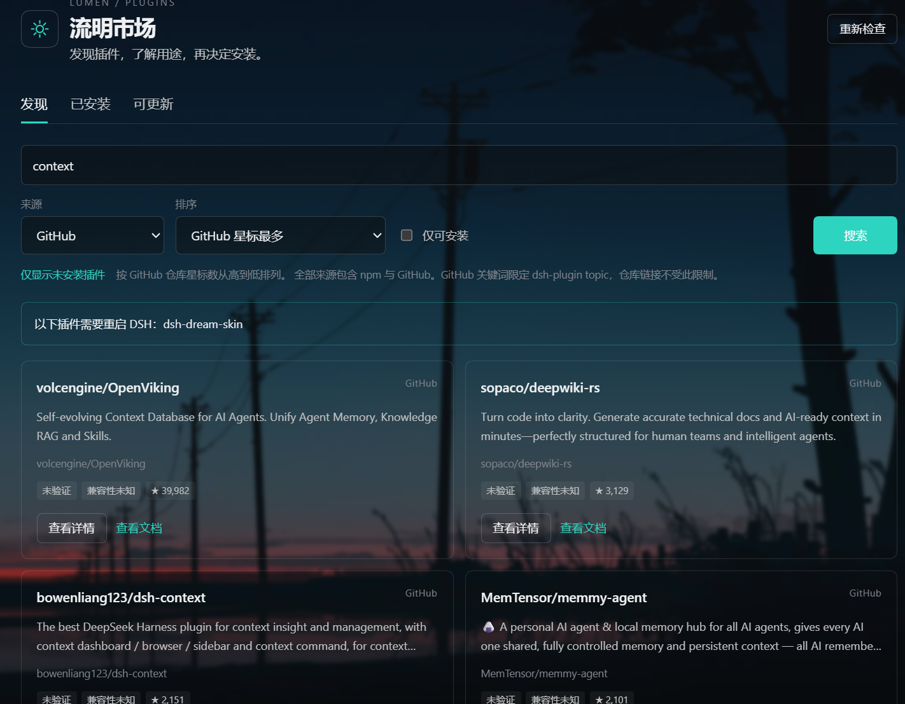

# 流明市场 · Lumen Market

为 [DeepSeek Harness](https://github.com/deepseek-ai/deepseek-harness) 提供 npm 与 GitHub 插件发现、兼容性查验和安装管理。

[npm](https://www.npmjs.com/package/dsh-lumen-market) · [问题反馈](https://github.com/Femad-6/dsh-lumen-market/issues)

当前版本：**[0.6.0](https://github.com/Femad-6/dsh-lumen-market/tree/v0.6.0)**。

工作区中的 **0.7.1 为本地候选版，尚未发布**：增加可维护的安装源、脚本授权重试及实时安装日志，见[安装源说明](docs/INSTALLATION-SOURCES.md)。

本版包含配置备份、兼容性确认、可恢复的一键升级和全新图标，详见[更新记录](CHANGELOG.md#060--2026-10-28)。

## 功能

- 搜索 npm 与 GitHub 插件，查看介绍、源码和文档。
- 发现页只展示未安装插件，每页 21 项，支持来源筛选和 GitHub 排序。
- 不输入关键词时，选择「GitHub 星标最多」即可查看 `dsh-plugin` 范围内总 Star 最多的插件。
- 支持「GitHub 一周 Star 增长最多」：对匹配范围内总 Star 排名前列的最多 50 个候选统计周增量，再按新增 Star 排序。卡片显示「近7天 +N」；按 GitHub 提供的完整日数据统计，截止昨日，不是精确滚动 168 小时，也不是全 GitHub 周增榜。
- 安装前查验兼容性，通过 DSH 官方管理器安装、更新和卸载。
- 兼容性区分「版本声明匹配」「冲突」和「未声明」。按宿主规则优先检查 `engines.dsh`，无该字段时检查 DSH peer；另检查 Node.js 和作者的明确兼容范围。未声明的插件需阅读提示后确认，不会自动显示为已兼容。
- 在发现卡片或详情中点击「一键安装」，自动查验目标，通过后直接安装；也可使用「安装预览」先查看目标。尚未查验的 GitHub 候选支持直接发起查验，查验失败会显示原因并停止安装。
- 查看已安装插件与可用更新，显示操作进度和重启提醒；可升级插件显示小灯提示。
- 安装时显示实时日志、当前源、已耗时和最后活动时间。60 秒没有新活动时提示检查日志或取消；完成和失败后保留过程记录。源尝试次数不是下载百分比；本功能不修改官方超时或强制换源策略。
- 已安装页支持按名称、简介即时搜索，忽略大小写，支持清空；本地筛选不需要联网。
- “有新版”与“当前可升级”分别显示。支持保留配置和加载顺序的目标提供「一键升级」：确认后校验安装与恢复包、备份配置，再由官方管理器卸载旧版并安装固定新版。不能安全重装的目标保留升级方法。
- 可输入确切版本并查验，查验不会安装或卸载；重装必须单独点击「确认卸载并升级」，目标版本与已校验安装包固定，不随 `latest` 变化。
- 切换标签或离开流明市场后会清空搜索词，并将来源、排序、页码和「仅可安装」恢复默认，再进入时显示未搜索的列表。
- 本地保存发现结果，查询失败或限流时继续显示缓存。
- 「安装源」可导入 JSON、添加 HTTPS 源地址并手动更新；详情中的「加入安装源并缓存」保存固定 commit 的实际安装包。备用地址需 SHA-512，已缓存的归档可离线复用。
- 普通新装遇到构建脚本拦截时，可查看官方返回的完整名单，明确允许后在市场内重试；许可通过官方管理器保存到当前 Profile。
- 「配置备份」可保存本机 Profile 的组合配置，导出不含配置正文和凭据的插件清单。恢复预览展示版本、来源、固定 commit、启用状态、加载顺序及配置文件差异，保留本机新增插件，不自动覆盖当前环境。
- 保存成功查验过的安装目标。遇到网络故障、超时或限流时，可从缓存发起安装，界面显示「使用缓存安装」和缓存时间；npm 固定确切版本，GitHub 固定 commit。缓存按 DSH 配置隔离，重启后仍可使用。

## 安装

在 DSH 的「插件 → 添加插件」中输入：

```text
dsh-lumen-market@0.6.0
```

按官方管理器提示完成安装。需要支持官方插件管理器的 DeepSeek Harness；Node.js `^22.19.0 || >=24.0.0`。

安装后从侧栏打开「流明市场」，在发现页搜索插件，点击「一键安装」或先查看「安装预览」；在已安装页搜索、管理插件，在可更新页检查版本。按宿主提示正常退出并重启 DSH，使插件生效。

如果默认 npm 镜像尚未同步目标版本，可在官方插件管理器中使用 npm 官方源安装包链接：

```text
https://registry.npmjs.org/dsh-lumen-market/-/dsh-lumen-market-0.6.0.tgz
```

## 使用须知

- 配置备份从页面底部进入。原始配置可能含私有设置，只保存在当前 Profile 的 `.lumen-market/backups/`；导出的 JSON 仅含插件清单及状态，不包含原始 YAML、API Key 或本机路径。恢复入口目前是只读差异预览。
- 卸载重装前会再次检查旧版是否仍能在当前宿主恢复；明确冲突或无法取得有效恢复包时，在卸载前停止。

- npm 来源以及本市场有完整校验来源记录的固定安装包支持检查更新；普通本地链接和 Git 来源暂不支持按包名升级。重装后的安装包与来源记录保存在当前 Profile 的 `.lumen-market/reinstall/`，仍在使用时请保留此目录。
- 当前 DSH 宿主可能禁止在配置运行时覆盖已有依赖。市场优先使用支持的直接升级；否则仅对官方允许卸载、能保持当前加载顺序的 npm 插件提供确认后的卸载重装。市场自身、官方组件、普通本地/Git 来源或无法保留顺序的目标保留手动升级方法；不会直接删除插件目录。
- 用户可确认安装刚发布的确切版本，依赖仍遵守官方包管理器策略。重装前必须取得并校验旧版恢复包；新版失败时用本地恢复包恢复旧版，恢复失败则保留记录并停止。普通升级失败不会静默转换为卸载重装。
- Star 数目前仅显示在 GitHub 来源的结果中。
- GitHub 查询可能受到限流；已有缓存时会继续展示，并标注缓存时间。
- 周增榜按同一批候选分页，统计结果缓存 15 分钟；「重新检查」可主动刷新。界面显示成功统计数量与时间，未知增量排在末尾；全部统计失败时保留同查询的已有缓存。
- 缓存安装仅适用于已经成功查验并保存过的目标；仅有名称、简介的搜索记录不足以安装。仍会检查本机兼容性、来源冲突和已安装状态，明确的无效清单、目标不存在或官方拒绝不会用旧缓存绕过。下载插件及依赖仍需网络；不提供离线升级。
- 截图中的背景和配色来自 DSH 宿主主题，不是插件自带皮肤。

[更新记录](CHANGELOG.md) · [配置备份说明](docs/BACKUPS.md)

## 兼容性与权限

Node.js 支持范围为 `^22.19.0 || >=24.0.0`；DSH 的明确版本声明和逐版本验收状态见 `package.json` 的 `dsh.compatibility`。本插件需要读取 Profile、写入本地缓存和访问 npm/GitHub，可选使用专用 GitHub Token，并通过官方管理器执行插件变更。建议商城采用 `user-reviewed` 策略；权限声明不代表自动审核通过。

详细说明：[依赖、外部服务与失败边界](docs/STORE-REVIEW.md) · [隔离 Profile 验收结果](docs/STORE-VALIDATION.md)。

## 界面预览

**发现插件**



**已安装插件与升级提示灯**



**查看可用更新**



**GitHub 星标排序**



截图由实际使用界面提供，版本和查询状态以拍摄时为准。

## 许可证

[MIT](LICENSE)
